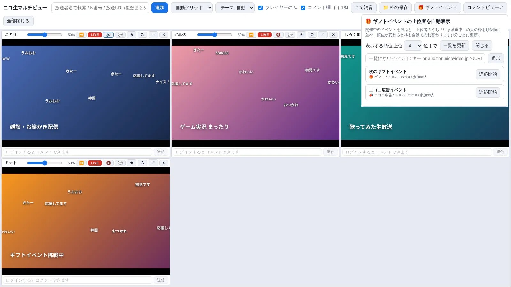

# ニコ生マルチビュー

ニコニコ生放送を、複数の窓で同時に見るための Windows 用アプリです(非公式)。
インストール不要。zip を展開して `NicoMultiView.exe` を起動するだけで使えます。

**サイト: https://nico-multiview.pages.dev**

## ダウンロード

[最新版をダウンロード(Windows 10 / 11 64bit)](https://github.com/kako774/nico-multiview/releases/latest/download/NicoMultiView-win.zip)

過去のバージョンは [Releases](https://github.com/kako774/nico-multiview/releases) にあります。

## できること

- 最大12枠を同時に表示(自動グリッド / メイン+サブ / 横一列 / 縦一列)。枠はドラッグで並べ替え
- 枠ごとの音量調整と音声のON/OFF
- コメントの投稿と、枠ごとの表示切替
- 全枠のコメントをまとめて見られる統合コメントビューア(別窓。位置と大きさは次回も保持)
- 放送者名の検索、lv番号・URLの貼り付け、ブラウザからのリンクのドラッグ&ドロップで枠を追加
- ギフトイベントの上位者を順位順に自動表示(1〜3位は金・銀・銅、召喚獣の数も表示)
- タイムシフトの巻き戻し(⏪ / LIVE ボタン。ニコ生プレミアム会員向け)
- 開いている枠の保存と呼び出し
- ライト / ダークテーマ

## 使い方

1. zip を好きな場所に展開します(フォルダの中身は移動・削除しないでください)。
2. `NicoMultiView.exe` をダブルクリックします。
3. 放送者名を検索するか、放送URLを貼り付けて枠を追加します。コメントするときは「ニコニコにログイン」からログインします。

初回起動で Windows が「PCが保護されました」と表示した場合は、「詳細情報」→「実行」で起動できます(署名していないためです)。
アンインストールは、展開したフォルダを削除するだけです。

## ご利用にあたって

- 個人が作った**非公式**ツールです。株式会社ドワンゴ・株式会社KADOKAWA および「ニコニコ」サービスとは関係ありません。
- ログインはニコニコ公式のログイン画面で行います。パスワードをこのアプリが保存することはありません。
- ニコニコ側の仕様が変わると、一部の機能が使えなくなることがあります。
- 本ソフトウェアは現状のまま提供されます。利用によって生じた損害について、作者は責任を負いません。自己責任でご利用ください。
- 映像・コメントなどの権利は配信者・投稿者に帰属します。録画・転載・再配信は、配信者の許可と各サービスの規約に従ってください。

## ライセンス

このアプリは Electron(MIT)と Chromium を含みます。配布フォルダの `LICENSE.electron.txt` と `LICENSES.chromium.html` に全文があります。削除しないでください。

## このリポジトリについて

配布サイト(静的ページ)のソースです。ビルドは不要で、Cloudflare Pages からそのまま公開しています。
